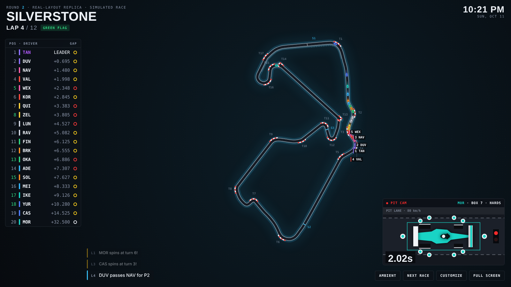
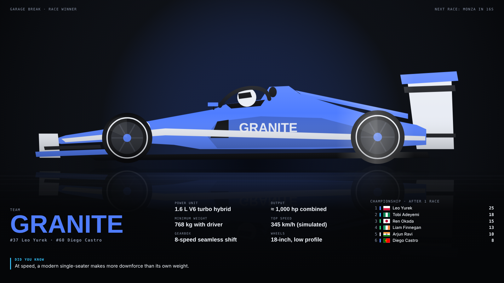
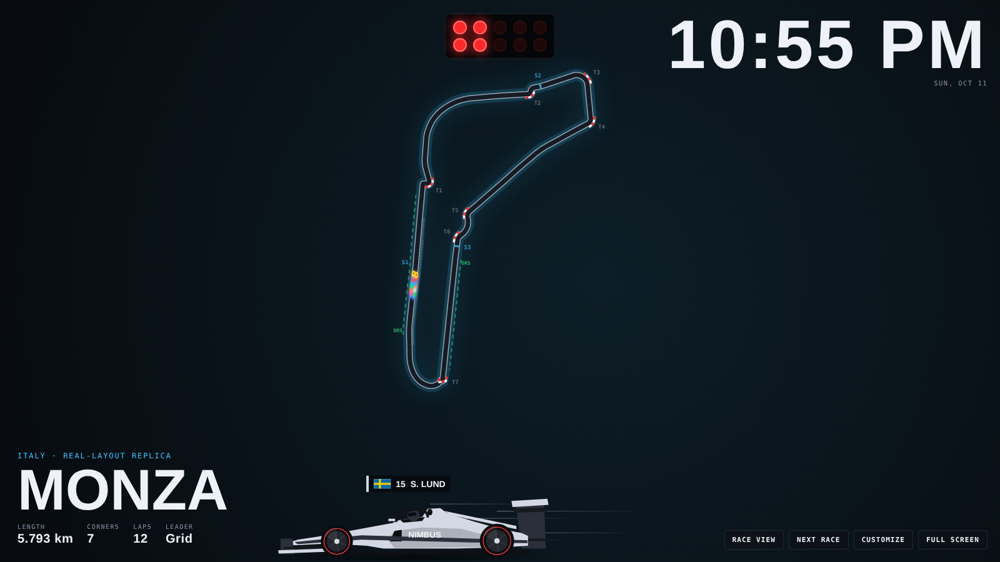

# Living Racetrack · Pit Wall

**A racetrack that is always alive.** Pit Wall turns any screen into an animated motorsport display for your wall: twenty cars racing nonstop around a glowing circuit, with live timing, pit stops, crashes, safety cars, rain and a garage break between races.

It runs in any modern browser, installs like an app, works offline, and can run a Raspberry Pi behind a TV as a dedicated wall display.


> Living Racetrack is an original project by **Arun Pun**. The concept, design, code, teams, drivers and the four original circuits were created for this project. See [docs/ORIGIN.md](docs/ORIGIN.md).

---

## What it does

| | |
|---|---|
| **Race view** | 20 cars, a live timing tower with flags, gaps and tyre compounds, start lights, DRS overtakes, fastest laps, team radio and a race feed. |
| **Your drivers** | Put yourself and your friends on the grid: names, national flags (50 countries) and car numbers. |
| **Season** | Every race scores points (25-18-15…, plus fastest lap). Standings carry over, so friends can race each other all season. |
| **Drive-bys** | A full-size car with a driver's name and flag drives across the screen, slowing down mid-screen so you can read it. The desktop app does it above your taskbar while you work. |
| **Send a drive-by** | Make a link or QR code for a birthday, congratulations, good luck or your own words. When someone opens it, your car drives across their screen with the message and confetti. Share it by email, text or any app. |
| **Camera views** | TV map, a zoomed chase cam that follows your car through every corner, and an onboard driver's-eye view built from the real circuit shape, with the cars ahead, barriers, kerbs and a live steering-wheel display. Press `V`. |
| **Career mode** | Start in the slowest car, earn development points, upgrade engine, aero and tyres, and sign for better teams at the end of each 8-race season. |
| **Elimination Cup** | A knockout tournament: the slowest quarter is out after every race until four drivers race the final. |
| **Crashes and recovery** | Crashed cars stay where they stopped until a recovery crane lifts them over the wall and drives off. The safety car leaves from the pit exit, leads the pack and peels back into the pit lane. |
| **Podium celebration** | The top three climb the podium and spray champagne after every race. |
| **Fantasy league** | Each friend backs two drivers; their season points decide who wins the league. |
| **Real race weekends** | On a real race weekend, Pit Wall races that circuit and counts down to the next one. Calendar data only, never live timing. |
| **Realistic circuit map** | Grass, run-off, gravel traps, tyre walls, grandstands, pit garages and grid boxes, plus a world locator. Neon night style and three zoom levels. |
| **Pit-board reminders** | Drink water, stretch, rest your eyes, or your own message, carried past on a pit board at the interval you choose. |
| **Private by design** | No accounts, no tracking, no network requests. Settings stay on your device. See [SECURITY.md](SECURITY.md). |
| **Incidents** | Spins with tyre smoke, crashes into the barrier with debris, yellow flags, safety cars, red flags with a standing restart, and punctures after contact. |
| **Pit cam** | An overhead pit-box camera plays every stop in real time: crew, jacks, wheel change, release light and the stop clock. |
| **Weather** | Dry, wet or a passing shower. Teams switch to intermediates when it rains and back to slicks as it dries. |
| **Garage break** | Between races, an original single-seater rolls into a studio in the winning team's livery, with specs and a racing fact. |
| **Ambient view** | A calm mode with a large clock and circuit details while the cars keep lapping quietly. |
| **44 tracks** | 4 original circuits plus 40 real-layout replicas traced from open map data, named by location. |
| **Your own tracks** | Import any circuit as a GeoJSON file, for example a local kart track drawn on geojson.io. |
| **Customize** | Driver names, flags and numbers, team names and liveries, favourite team, race length, pace, weather, incidents, drive-bys, night dimming. |





## Run it

**Quickest:** open `dist/pit-wall.html` in a browser (run `npm run build` first if the folder is missing). It is one self-contained file.

**From source:**

```bash
npm start          # serves the app at http://localhost:8080 (no dependencies to install)
```

**On a wall:** open it on a TV browser, a tablet, or a small PC behind a monitor, then press **Full screen**. Controls hide after a few seconds.

**As an app:** from Chrome or Edge, choose *Install app*. It keeps working without Wi-Fi.

**Dedicated Raspberry Pi display:**

```bash
git clone https://github.com/imarun-pun/living-racetrack.git
cd living-racetrack
bash install/raspberry-pi-kiosk.sh
sudo reboot
```

The Pi boots straight into Pit Wall in kiosk mode, hides the cursor and keeps the screen awake.

**Desktop app (drive-bys above your taskbar):** Pit Wall also comes as a small Windows, macOS and Linux app. It opens the display in a window and lives in the system tray. Every few minutes a car with one of your drivers' names drives across the bottom of your screen, right above the taskbar, while you work. It never takes focus and clicks pass straight through it. Tray menu: *Drive by now*, how often (5, 15, 30 or 60 minutes), drink-water, stretch, rest-your-eyes and custom-message reminders, pause, engine sound, start at login.

Get the installer from the *Actions* tab: open **Build desktop app**, click **Run workflow**, and download *PitWall-windows-latest* (or macOS / Linux) from the finished run. To run it from source instead:

```bash
cd desktop
npm install
npm start
```

The installers are not code-signed yet, so Windows SmartScreen and macOS Gatekeeper will ask you to confirm the first time.

**GitHub Pages:** the included workflow publishes the site on every push to `main`. Turn it on under *Settings → Pages → Source: GitHub Actions*.

### Keys

`A` ambient · `N` next race · `C` customize · `F` full screen · `P` pause · `D` drive-by · `W` water reminder · `V` change view · `Esc` close panel

## Project layout

```
index.html              page structure
css/style.css           visual design
js/data.js              teams, drivers, tyres, points, original circuits, default settings
js/flags.js             50 national flags drawn on canvas
js/tracks-real.js       real-layout track pack (generated)
js/circuit.js           spline geometry, curvature, speed profile, corners, track import
js/sim.js               race simulation: pace, traffic, pit stops, weather, incidents, flags
js/render.js            canvas drawing: track, cars, weather, effects
js/pitcam.js            pit-stop camera
js/garage.js            garage break and the original car design
js/driveby.js           drive-by car with name tag (web and desktop)
js/celebrate.js         podium and champagne
js/onboard.js           onboard (driver's-eye) camera
js/share.js, send.html, go.html   send-a-drive-by links and QR codes
js/calendar.js          real race-weekend dates
js/world.js, locator.js world locator map
js/vendor/qrcode.js     QR code generator (MIT)
js/main.js              app shell: race weekend loop, HUD, settings, controls
tools/                  local server, single-file build, track converter
install/                Raspberry Pi kiosk installer
desktop/                Electron tray app: display window and drive-by overlay
docs/                   origin record, roadmap, customization guide
```

## How the simulation works

Each circuit is smoothed into 1,600 evenly spaced samples. Curvature at each point sets a cornering speed limit, and forward and backward passes add acceleration and braking zones. That gives every track a realistic speed profile; simulated lap times land within a few seconds of real ones on the replica layouts.

Each car has its own pace, tyre wear, and a little noise. Cars follow each other in corners and pass on straights, with a DRS boost when they are within a second of the car ahead in a DRS zone. Gaps in the timing tower come from 40 timing points per lap, the same way real timing loops work. Incidents are more likely in corners, in the rain, and on slick tyres in the wet.

Everything shown is a simulation. It is labelled as such on screen and never presented as live data.

## Customizing

See [docs/CUSTOMIZING.md](docs/CUSTOMIZING.md) for the track file format, team settings and how to add circuits to the built-in packs.

## Roadmap and product plan

See [docs/ROADMAP.md](docs/ROADMAP.md): live sim-racing telemetry, smart lights that follow flags, a phone remote, track packs, hardware editions and subscription tiers.

## License

Source-available under the [PolyForm Noncommercial License 1.0.0](LICENSE.md). You may run, study and modify Pit Wall for personal, educational and other noncommercial use. Selling it, offering it as a paid service, or bundling it with hardware for sale needs a separate commercial license from the author. See [NOTICE](NOTICE).

Third-party material is listed in [THIRD_PARTY.md](THIRD_PARTY.md).

## Disclaimer

Living Racetrack is an independent project. It is not affiliated with, endorsed by or connected to Formula 1, the FIA, any racing series, team, driver or circuit. Teams, drivers and car designs shown are fictional. Real-world layouts are named by their location only and are used for illustration.
